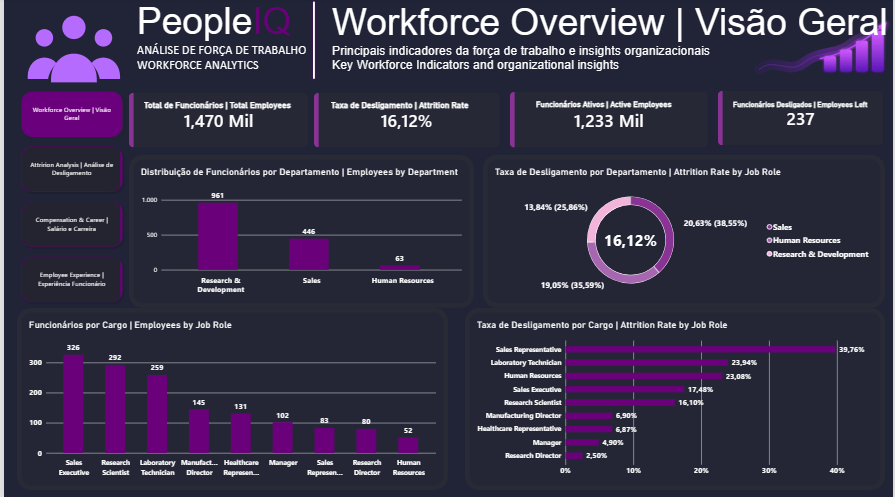
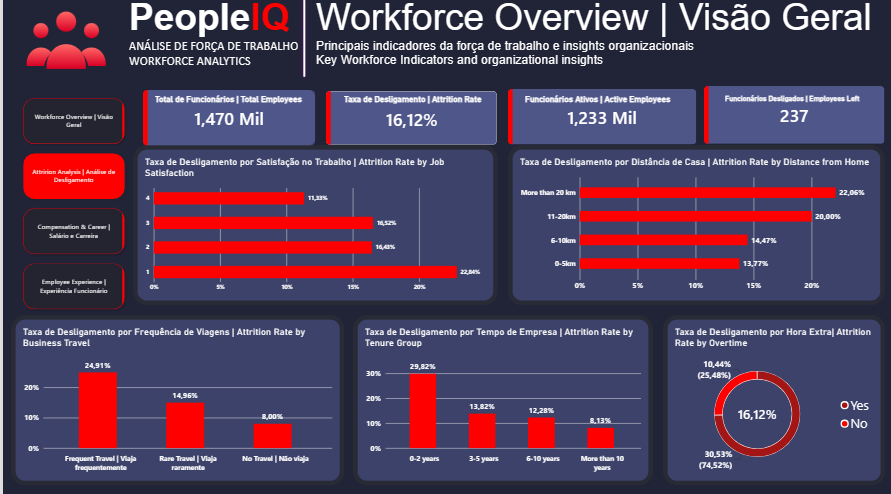
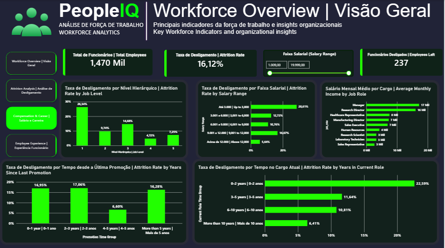
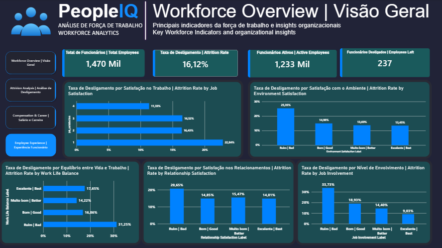

# PeopleIQ | Strategic Workforce Analysis

### Turning workforce data into strategic business insights.

**An end-to-end People Analytics project combining SQL, PostgreSQL, Python, statistical analysis, Machine Learning, and Power BI.**

PeopleIQ is an end-to-end workforce analytics project designed to investigate employee attrition patterns, identify workforce segments that deserve management attention, and translate analytical findings into actionable business insights.

The project follows the analytical workflow from data ingestion and database development to statistical investigation, predictive modeling, and interactive business intelligence reporting.

---

## 1. Executive Overview

Employee attrition is an important workforce management challenge. Understanding where employee departures concentrate and which workforce characteristics are associated with attrition can help organizations investigate retention challenges more effectively.

PeopleIQ explores these questions through an integrated analytical solution built around employee demographics, job characteristics, compensation, career progression, workplace conditions, and satisfaction indicators.

### Project at a Glance

| Category | Details |
|---|---|
| Project | PeopleIQ — Strategic Workforce Analysis |
| Domain | People Analytics / HR Analytics |
| Dataset | IBM HR Analytics Employee Attrition & Performance |
| Records analyzed | 1,470 employees |
| Original variables | 35 |
| Employees who left | 237 |
| Overall attrition share | 16.12% |
| Database | PostgreSQL |
| Query language | SQL |
| Data analysis | Python |
| Machine Learning | Scikit-learn |
| Data visualization | Power BI |
| Project status | Completed |

## 2. Business Problem

Organizations need more than a general attrition indicator to understand workforce dynamics.

A single overall percentage does not reveal which departments, job roles, career stages, compensation ranges, or workplace conditions are associated with higher employee departure rates.

The central business question guiding PeopleIQ is:

**Which workforce characteristics are most strongly associated with employee attrition, and how can analytical insights support more focused retention strategies?**

The project investigates workforce patterns and develops analytical evidence that can help HR and business leaders prioritize further investigation.

## 3. Business Objectives

- Measure and analyze employee attrition across the workforce.
- Identify departments and job roles with higher attrition rates.
- Investigate the relationship between overtime, business travel, and employee departures.
- Explore how tenure, career progression, and compensation relate to attrition.
- Evaluate employee satisfaction, work-life balance, and job involvement patterns.
- Apply statistical analysis to assess relationships between multiple workforce characteristics and attrition.
- Develop and evaluate a predictive classification model.
- Deliver an interactive Power BI report to communicate findings and support business discussions.

## 4. Key Business Questions

| Business Area | Analytical Question |
|---|---|
| Workforce Structure | How is the workforce distributed across departments and job roles? |
| Attrition | Which departments and job roles have the highest attrition rates? |
| Work Conditions | How does overtime relate to employee attrition? |
| Business Travel | Do attrition rates differ by travel frequency? |
| Employee Tenure | At which career stages is attrition more concentrated? |
| Compensation | How do attrition rates vary across salary ranges and job levels? |
| Career Development | How are promotion history and time in the current role associated with attrition? |
| Employee Experience | How do satisfaction and work-life balance indicators relate to attrition? |
| Predictive Analytics | How effectively can a classification model identify attrition cases in unseen data? |

## 5. Key Findings & Business Insights

The analysis identified meaningful differences in attrition rates across several workforce segments.

### Workforce Overview

- **1,470** employee records analyzed.
- **237** employees classified as having left.
- **16.12%** overall attrition share in the dataset.
- **83.88%** of employees classified as active.

### Work Conditions

| Segment | Attrition Rate |
|---|---:|
| Employees working overtime | 30.53% |
| Employees not working overtime | 10.44% |

The observed difference highlights overtime as an important area for further workforce investigation.

### Employee Tenure

| Years at Company | Attrition Rate |
|---|---:|
| 0–2 years | 29.82% |
| 3–5 years | 13.82% |
| 6–10 years | 12.28% |
| More than 10 years | 8.13% |

The highest attrition rate appears among employees with up to two years at the company, highlighting early employee experience and onboarding as potential areas for further investigation.

### Compensation

| Monthly Income Range | Attrition Rate |
|---|---:|
| Up to 3,000 | 28.61% |
| 3,001–6,000 | — |
| 6,001–9,000 | — |
| 9,001–12,000 | — |
| Above 12,000 | 5.64% |

The lowest income range has the highest attrition rate among the displayed income groups. This finding supports further investigation into compensation, career progression, and job characteristics.

*Income values are presented in the dataset's original numerical units; the source does not specify a currency.*

### Job Role

The Sales Representative role presented an attrition rate of **39.76%**, the highest among the job roles analyzed.

This identifies a specific workforce segment for deeper investigation into job demands, working conditions, compensation, and career opportunities.

### Business Implications

The findings suggest several areas where an HR team could prioritize further investigation:

1. Review overtime patterns and workload distribution.
2. Evaluate onboarding and early-career employee experience.
3. Investigate retention challenges in high-attrition job roles.
4. Review compensation and career progression across employee segments.
5. Explore satisfaction and workplace experience indicators.

These are evidence-informed investigation priorities, not claims that a particular intervention has already reduced attrition.

## 6. Power BI — Interactive Workforce Intelligence

The Power BI report translates the analytical work into an interactive business intelligence experience.

It contains four analytical pages:

### 01. Workforce Overview
A consolidated view of workforce composition, employee distribution, and attrition across departments and job roles.

### 02. Attrition Analysis
An investigation of attrition patterns across overtime, job satisfaction, business travel, tenure, and commuting distance.

### 03. Compensation & Career
An analysis of compensation ranges, job levels, average monthly income, promotion history, and time in current roles.

### 04. Employee Experience
An exploration of job satisfaction, environment satisfaction, work-life balance, relationship satisfaction, and job involvement.

The report includes interactive filtering and contextual KPI indicators to help users explore different workforce segments.

## 7. Data Architecture & Technical Workflow

The project integrates database development, analytical processing, and business intelligence reporting.

**Data workflow:**

1. Source dataset ingestion.
2. Data quality assessment and validation.
3. PostgreSQL database organization.
4. SQL transformations and analytical views.
5. Python exploratory and statistical analysis.
6. Predictive model development and evaluation.
7. Power BI data modeling and dashboard development.
8. Business interpretation and reporting.

### PostgreSQL Architecture

The database uses two schemas:

- `raw`: original source data.
- `analytics`: analytical views prepared for reporting.

The analytical layer includes:

- `analytics.vw_workforce_overview`
- `analytics.vw_attrition_analysis`
- `analytics.vw_employee_experience`
- `analytics.vw_compensation_career`
- `analytics.vw_dashboard_workforce`

The consolidated dashboard view contains 1,470 employee records and 1,470 distinct employee identifiers.

## 8. Statistical Analysis & Predictive Modeling

The project uses statistical analysis and Logistic Regression to investigate employee attrition from complementary perspectives.

### Predictive Classification Model

The final classification model was evaluated on a held-out test set of 294 employee records.

| Evaluation Metric | Result |
|---|---:|
| Accuracy | 81.29% |
| Precision | 43.55% |
| Recall | 57.45% |
| F1-score | 49.54% |
| ROC-AUC | 0.8032 |
| Classification threshold | 0.60 |

The selected threshold prioritizes the identification of more attrition cases while balancing precision and recall.

### Statistical Modeling

A separate multivariable Logistic Regression analysis was used to investigate adjusted associations between workforce characteristics and attrition.

Selected findings included:

- Overtime: adjusted odds ratio of approximately 7.06.
- Frequent business travel: adjusted odds ratio of approximately 7.81.
- Laboratory Technician role: adjusted odds ratio of approximately 7.93.
- Sales Representative role: adjusted odds ratio of approximately 13.28.
- 
## Dashboard Preview

### 1. Workforce Overview

### 2. Attrition Analysis

### 3. Compensation & Career

### 4. Employee Experience

For continuous predictors, the model used standardized variables. Categorical odds ratios are interpreted relative to their respective reference categories.

These results describe associations after adjustment for the other variables included in the model. They do not establish causal effects.

### Model Evaluation

The predictive model was assessed using multiple classification metrics rather than relying on accuracy alone.

This approach is particularly important because attrition cases represent a minority of the dataset.

The model provides an analytical assessment of classification performance, rather than a validated operational employee-risk system.

## 9. Tools & Technologies

| Technology | Application |
|---|---|
| PostgreSQL 18 | Database management and analytical data organization |
| pgAdmin 4 | Database administration |
| SQL | Data querying, transformations, and analytical views |
| Python | Data analysis and statistical investigation |
| Pandas & NumPy | Data manipulation and numerical analysis |
| Scikit-learn | Predictive modeling and model evaluation |
| Power BI | Interactive dashboards and business intelligence |
| DAX | Measures and analytical calculations |
| GitHub | Project documentation and version control |

## 10. Project Deliverables

- PostgreSQL database with raw and analytical schemas.
- SQL analytical views and queries.
- Python-based exploratory and statistical analysis.
- Logistic Regression modeling and evaluation.
- Four-page interactive Power BI report.
- Bilingual project documentation.
- Business findings and strategic investigation priorities.

## 11. Dataset & Source

**IBM HR Analytics Employee Attrition & Performance**

The project uses the publicly available dataset commonly distributed through Kaggle.

Dataset source: [IBM HR Analytics Employee Attrition & Performance — Kaggle](https://www.kaggle.com/datasets/pavansubhasht/ibm-hr-analytics-attrition-dataset)

The dataset contains 1,470 records and 35 original variables covering employee demographics, job characteristics, compensation, satisfaction, work conditions, and attrition.

The dataset is synthetic and does not represent actual IBM employee records.

## 12. Analytical Scope

The analysis uses a single cross-sectional dataset. The attrition percentage represents the share of records labeled as attrition, not an annual employee turnover rate.

The source does not provide employment dates, termination dates, or a distinction between voluntary and involuntary departures.

The reported income values have no documented currency in the source.

The statistical and predictive findings are intended for analytical exploration and portfolio demonstration, not as a substitute for organizational validation or individual employment decisions.

## 13. Project Status

**Completed**

PeopleIQ delivers an end-to-end HR Analytics workflow, integrating database development, SQL analysis, Python, statistical modeling, predictive evaluation, and interactive Power BI reporting.

The project demonstrates how multiple analytical tools can be combined to investigate workforce patterns and communicate evidence-based insights for business decision-making.

## Language

- [Português (Brasil)](README.pt-BR.md)

---

**PeopleIQ | Strategic Workforce Analysis**  
*End-to-End People Analytics & Business Intelligence Portfolio Project*
