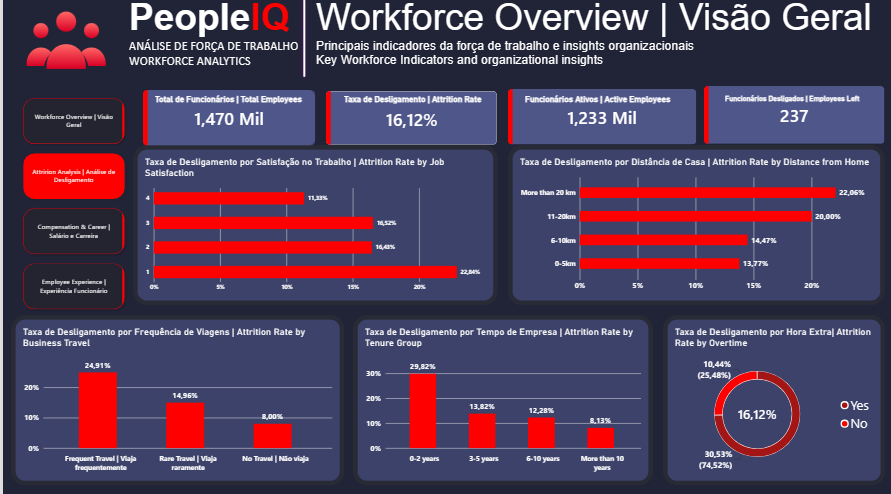
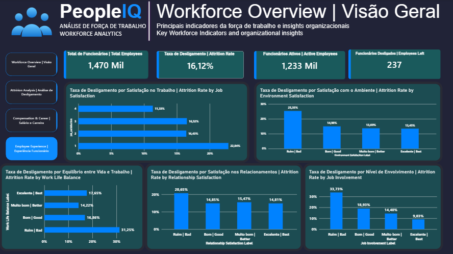

# PeopleIQ | Análise Estratégica da Força de Trabalho

### Transformando dados da força de trabalho em insights estratégicos para o negócio.

**Um projeto completo de People Analytics que integra SQL, PostgreSQL, Python, análise estatística, Machine Learning e Power BI.**

O PeopleIQ é um projeto de análise da força de trabalho desenvolvido para investigar padrões de desligamento de funcionários, identificar segmentos que merecem atenção gerencial e transformar resultados analíticos em insights relevantes para o negócio.

O projeto contempla um fluxo analítico completo, desde a ingestão dos dados e desenvolvimento do banco de dados até a investigação estatística, modelagem preditiva e construção de relatórios interativos de Business Intelligence.

---

## 1. Visão Executiva

A rotatividade de funcionários é um importante desafio para a gestão da força de trabalho. Compreender onde os desligamentos estão mais concentrados e quais características estão associadas a eles permite que as organizações investiguem seus desafios de retenção de maneira mais direcionada.

O PeopleIQ explora essas questões por meio de uma solução analítica integrada, considerando dados demográficos, características dos cargos, remuneração, progressão profissional, condições de trabalho e indicadores de satisfação.

### Visão Geral do Projeto

| Categoria | Detalhes |
|---|---|
| Projeto | PeopleIQ — Análise Estratégica da Força de Trabalho |
| Área | People Analytics / HR Analytics |
| Base de dados | IBM HR Analytics Employee Attrition & Performance |
| Registros analisados | 1.470 funcionários |
| Variáveis originais | 35 |
| Funcionários desligados | 237 |
| Participação de desligamentos | 16,12% |
| Banco de dados | PostgreSQL |
| Linguagem de consulta | SQL |
| Análise de dados | Python |
| Machine Learning | Scikit-learn |
| Visualização de dados | Power BI |
| Status | Concluído |

## 2. Problema de Negócio

As organizações precisam de mais do que um indicador geral de desligamentos para compreender a dinâmica da força de trabalho.

Uma única porcentagem não revela quais departamentos, cargos, estágios de carreira, faixas de remuneração ou condições de trabalho estão associados a maiores taxas de desligamento.

A principal pergunta de negócio que orienta o PeopleIQ é:

**Quais características da força de trabalho estão mais fortemente associadas aos desligamentos e como os insights analíticos podem apoiar estratégias de retenção mais direcionadas?**

O projeto investiga padrões da força de trabalho e desenvolve evidências analíticas que podem ajudar profissionais de RH e gestores a priorizar investigações.

## 3. Objetivos do Projeto

- Mensurar e analisar os desligamentos de funcionários.
- Identificar departamentos e cargos com maiores taxas de desligamento.
- Investigar a relação entre horas extras, viagens a trabalho e desligamentos.
- Explorar como tempo de empresa, progressão profissional e remuneração se relacionam com os desligamentos.
- Avaliar padrões de satisfação, equilíbrio entre vida pessoal e profissional e envolvimento no trabalho.
- Aplicar análise estatística para avaliar relações entre múltiplas características da força de trabalho e os desligamentos.
- Desenvolver e avaliar um modelo preditivo de classificação.
- Entregar um relatório interativo no Power BI para comunicar resultados e apoiar discussões de negócio.

## 4. Perguntas de Negócio

| Área | Pergunta Analítica |
|---|---|
| Estrutura da Força de Trabalho | Como os funcionários estão distribuídos entre departamentos e cargos? |
| Desligamentos | Quais departamentos e cargos apresentam maiores taxas de desligamento? |
| Condições de Trabalho | Como as horas extras se relacionam com os desligamentos? |
| Viagens a Trabalho | As taxas de desligamento variam conforme a frequência de viagens? |
| Tempo de Empresa | Em quais estágios da carreira os desligamentos estão mais concentrados? |
| Remuneração | Como as taxas variam entre faixas salariais e níveis hierárquicos? |
| Desenvolvimento de Carreira | Como o histórico de promoções e o tempo no cargo atual se relacionam com os desligamentos? |
| Experiência do Funcionário | Como os indicadores de satisfação e equilíbrio entre vida pessoal e profissional se relacionam com os desligamentos? |
| Análise Preditiva | Com que eficiência um modelo de classificação identifica casos de desligamento em dados não utilizados no treinamento? |

## 5. Principais Resultados e Insights de Negócio

A análise identificou diferenças relevantes nas taxas de desligamento entre diversos segmentos da força de trabalho.

### Visão Geral da Força de Trabalho

- **1.470** registros de funcionários analisados.
- **237** funcionários classificados como desligados.
- **16,12%** de participação geral de desligamentos na base.
- **83,88%** de funcionários classificados como ativos.

### Condições de Trabalho

| Segmento | Taxa de Desligamento |
|---|---:|
| Funcionários que fazem horas extras | 30,53% |
| Funcionários que não fazem horas extras | 10,44% |

A diferença observada destaca as horas extras como um importante tema para investigação sobre as condições de trabalho.

### Tempo de Empresa

| Tempo na Empresa | Taxa de Desligamento |
|---|---:|
| 0–2 anos | 29,82% |
| 3–5 anos | 13,82% |
| 6–10 anos | 12,28% |
| Mais de 10 anos | 8,13% |

A maior taxa de desligamento está entre funcionários com até dois anos de empresa, destacando a experiência inicial e o processo de integração como possíveis áreas de investigação.

### Remuneração

- Até 3.000: **28,61%** de desligamentos.
- Acima de 12.000: **5,64%** de desligamentos.

A menor faixa de remuneração apresenta a maior taxa de desligamento entre as faixas analisadas. Esse resultado apoia investigações adicionais sobre remuneração, progressão profissional e características dos cargos.

*Os valores de remuneração são apresentados nas unidades numéricas originais da base, pois a fonte não especifica uma moeda.*

### Cargos

O cargo de Sales Representative apresentou taxa de desligamento de **39,76%**, a maior entre os cargos analisados.

Esse resultado identifica um segmento específico da força de trabalho para investigações mais aprofundadas sobre exigências do cargo, condições de trabalho, remuneração e oportunidades de carreira.

### Implicações para o Negócio

Os resultados apontam áreas nas quais uma equipe de RH poderia priorizar investigações:

1. Revisar padrões de horas extras e distribuição de carga de trabalho.
2. Avaliar o processo de integração e a experiência dos funcionários nos primeiros anos.
3. Investigar desafios de retenção em cargos com maiores taxas de desligamento.
4. Revisar remuneração e progressão profissional entre diferentes segmentos.
5. Explorar indicadores de satisfação e experiência no ambiente de trabalho.

Essas são prioridades de investigação fundamentadas nos resultados, não afirmações de que alguma intervenção já tenha reduzido desligamentos.

## 6. Power BI — Inteligência Interativa sobre a Força de Trabalho

O relatório desenvolvido no Power BI transforma o trabalho analítico em uma experiência interativa de Business Intelligence.

Ele contém quatro páginas analíticas:

### 01. Workforce Overview | Visão Geral
Visão consolidada da composição da força de trabalho, distribuição dos funcionários e desligamentos por departamento e cargo.

### 02. Attrition Analysis | Análise de Desligamentos
Investigação dos padrões de desligamento considerando horas extras, satisfação profissional, viagens a trabalho, tempo de empresa e distância de casa.

### 03. Compensation & Career | Remuneração e Carreira
Análise das faixas de remuneração, níveis hierárquicos, remuneração mensal média, histórico de promoções e tempo nos cargos atuais.

### 04. Employee Experience | Experiência do Funcionário
Exploração de satisfação profissional, satisfação com o ambiente, equilíbrio entre vida pessoal e profissional, satisfação com relacionamentos e envolvimento no trabalho.

## Prévia dos Dashboards

### 1. Visão Geral da Força de Trabalho

### 2. Análise de Desligamentos

### 3. Remuneração e Carreira

### 4. Experiência do Funcionário

O relatório conta com filtros interativos e indicadores contextuais para permitir a exploração de diferentes segmentos da força de trabalho.

## 7. Arquitetura de Dados e Fluxo Técnico

O projeto integra desenvolvimento de banco de dados, processamento analítico e construção de relatórios de Business Intelligence.

**Fluxo de trabalho:**

1. Ingestão da base de dados original.
2. Avaliação e validação da qualidade dos dados.
3. Organização do banco de dados PostgreSQL.
4. Transformações SQL e criação de views analíticas.
5. Análise exploratória e estatística com Python.
6. Desenvolvimento e avaliação do modelo preditivo.
7. Modelagem de dados e construção do dashboard no Power BI.
8. Interpretação dos resultados e elaboração de recomendações.

### Arquitetura PostgreSQL

O banco de dados utiliza dois schemas:

- `raw`: dados originais da fonte.
- `analytics`: views analíticas preparadas para relatórios.

A camada analítica inclui:

- `analytics.vw_workforce_overview`
- `analytics.vw_attrition_analysis`
- `analytics.vw_employee_experience`
- `analytics.vw_compensation_career`
- `analytics.vw_dashboard_workforce`

A view consolidada do dashboard contém 1.470 registros e 1.470 identificadores distintos de funcionários.

## 8. Análise Estatística e Modelagem Preditiva

O projeto utiliza análise estatística e Regressão Logística para investigar os desligamentos sob perspectivas complementares.

### Modelo Preditivo de Classificação

O modelo final de classificação foi avaliado em um conjunto de teste separado, contendo 294 registros de funcionários.

| Métrica de Avaliação | Resultado |
|---|---:|
| Acurácia | 81,29% |
| Precisão | 43,55% |
| Recall | 57,45% |
| F1-score | 49,54% |
| ROC-AUC | 0,8032 |
| Limiar de classificação | 0,60 |

O limiar selecionado prioriza a identificação de mais casos de desligamento, equilibrando precisão e recall.

### Modelagem Estatística

Uma análise separada de Regressão Logística multivariada foi utilizada para investigar associações ajustadas entre características da força de trabalho e desligamentos.

Entre os resultados selecionados:

- Horas extras: razão de chances ajustada de aproximadamente 7,06.
- Viagens frequentes a trabalho: razão de chances ajustada de aproximadamente 7,81.
- Cargo de Laboratory Technician: razão de chances ajustada de aproximadamente 7,93.
- Cargo de Sales Representative: razão de chances ajustada de aproximadamente 13,28.

Para variáveis numéricas, o modelo utilizou variáveis padronizadas. As razões de chances das variáveis categóricas são interpretadas em relação às respectivas categorias de referência.

Esses resultados representam associações após o ajuste pelas demais variáveis incluídas no modelo. Não estabelecem relações de causa e efeito.

### Avaliação do Modelo

O modelo preditivo foi avaliado por meio de múltiplas métricas de classificação, em vez de depender exclusivamente da acurácia.

Essa abordagem é especialmente importante porque os casos de desligamento representam uma parcela minoritária da base.

O modelo fornece uma avaliação analítica do desempenho de classificação, e não um sistema operacional validado de risco individual de desligamento.

## 9. Ferramentas e Tecnologias

| Tecnologia | Aplicação |
|---|---|
| PostgreSQL 18 | Gerenciamento do banco de dados e organização analítica |
| pgAdmin 4 | Administração do banco de dados |
| SQL | Consultas, transformações e views analíticas |
| Python | Análise de dados e investigação estatística |
| Pandas e NumPy | Manipulação e análise numérica |
| Scikit-learn | Modelagem preditiva e avaliação |
| Power BI | Dashboards interativos e Business Intelligence |
| DAX | Medidas e cálculos analíticos |
| GitHub | Documentação e controle de versão |

## 10. Entregáveis do Projeto

- Banco de dados PostgreSQL com schemas raw e analytics.
- Views e consultas analíticas em SQL.
- Análise exploratória e estatística desenvolvida em Python.
- Modelagem de Regressão Logística e avaliação dos resultados.
- Relatório interativo no Power BI com quatro páginas.
- Documentação bilíngue do projeto.
- Principais descobertas e prioridades de investigação estratégica.

## 11. Base de Dados e Fonte

**IBM HR Analytics Employee Attrition & Performance**

O projeto utiliza uma base de dados publicamente disponível, amplamente distribuída por meio do Kaggle.

Fonte: [IBM HR Analytics Employee Attrition & Performance — Kaggle](https://www.kaggle.com/datasets/pavansubhasht/ibm-hr-analytics-attrition-dataset)

A base contém 1.470 registros e 35 variáveis originais, abrangendo dados demográficos, características dos cargos, remuneração, satisfação, condições de trabalho e desligamentos.

Os dados são sintéticos e não representam registros reais de funcionários da IBM.

## 12. Escopo Analítico

A análise utiliza uma base de dados transversal, sem dimensão temporal. A porcentagem de desligamentos representa a participação dos registros classificados como desligamento, e não uma taxa anual de rotatividade.

A fonte não contém datas de admissão ou desligamento, nem diferencia desligamentos voluntários e involuntários.

Os valores de remuneração não possuem moeda documentada na fonte.

Os resultados estatísticos e preditivos são destinados à exploração analítica e à demonstração em portfólio, não substituindo validação organizacional ou decisões individuais de emprego.

## 13. Status do Projeto

**Concluído**

O PeopleIQ entrega um fluxo completo de HR Analytics, integrando desenvolvimento de banco de dados, análise SQL, Python, modelagem estatística, avaliação preditiva e relatórios interativos no Power BI.

O projeto demonstra como diferentes ferramentas analíticas podem ser combinadas para investigar padrões da força de trabalho e comunicar insights fundamentados para apoiar decisões de negócio.

## Idioma

- [English](README.md)

---

**PeopleIQ | Análise Estratégica da Força de Trabalho**  
*Projeto de Portfólio em People Analytics e Business Intelligence — Ponta a Ponta*
